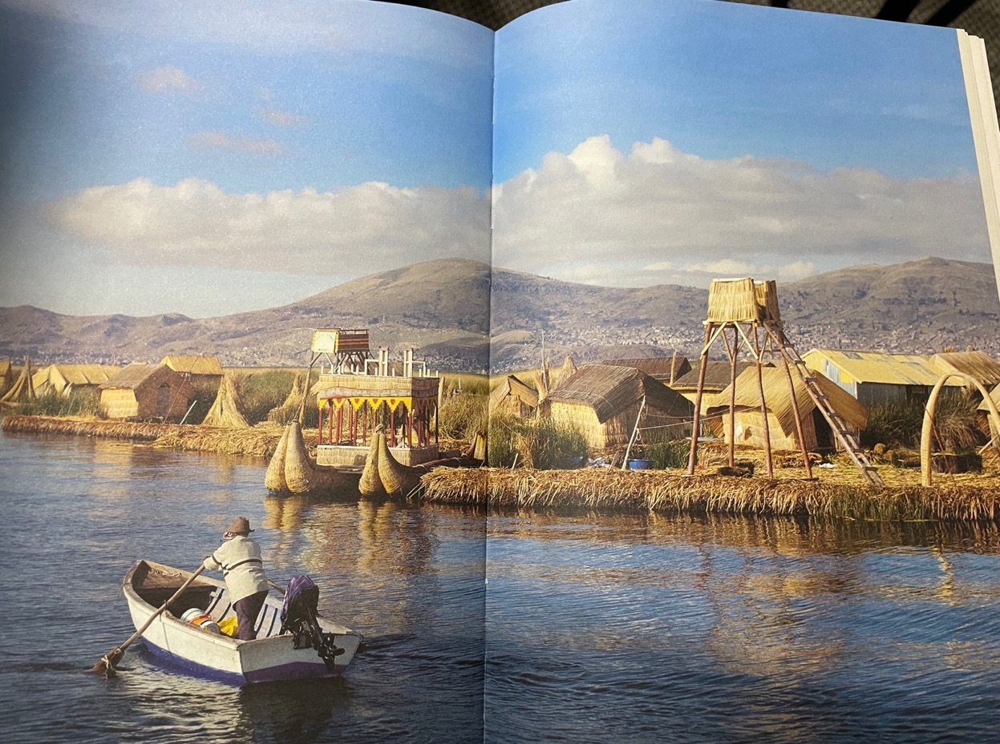

**Contexto**

Ensayo final del curso de Estética (EST-3000) del Magíster en Éticas Aplicadas, 2026. El PDF original quedó al final, en [Recursos](#recursos).

> “Don’t let them do it!” wailed Peter at the ceiling, as if he was talking to the house, the nursery. “Don’t let Father kill everything.” He turned to his father. “Oh, I hate you!”
>
> “Insults won’t get you anywhere.”
>
> “I wish you were dead!”
>
> “We were, for a long while. Now we’re going to really start living. Instead of being handled and massaged, we’re going to live.” [[1]](#nota-1)

El horror tecnológico presente en *La Pradera* (*The Veldt*) de Ray Bradbury atrapa desde la sensibilidad el sinsentido de la relación de las personas y la sociedad con la trayectoria tecnológica hegemónica en el Antropoceno. No se trata de un problema en la técnica en general, sino de algunas formas de tecnologización digital, sobre todo la de las grandes plataformas o *big tech*. Al sumergirnos en el vínculo de la familia Hadley con su *Happylife Home* –una casa que los viste, los alimenta, los arrulla para dormir–, es inevitable hacer un paralelo con esa deriva tecnológica, encarnada hoy en diversos productos y servicios de usos globales como las redes sociales o la inteligencia artificial. El horror en *The Veldt* no reside únicamente en su final explícito y terrible, sino en algo más perturbador: un mundo donde la tecnología opera como un ente que no nos odia, que simplemente funciona, y en ese funcionamiento eficiente e indiferente nos devora.

En este cuento la *nurturing room* es un personaje interesante. Su nombre revela bastante de su concepción, dado que está encargada de nutrir, de cuidar, de criar a los hijos de la familia, a Wendy y a Peter [[2]](#nota-2). Esto termina presentando una contradicción profunda, pues ese cuidado llevado a la absoluta eficiencia, y sin una brújula moral particular, termina llevando a los niños a cumplir la fantasía de la pradera africana sin límites y sin mediación posible de los padres. Esta habitación sacia el hambre de los niños en abundancia, los engorda sin abrazar consecuencia alguna, indiferente.

Precisamente, esta indiferencia es parte del núcleo del horror cósmico tal como se define en *El horror sobrenatural en la literatura* [[3]](#nota-3): la sensación de que hay fuerzas que nos superan radicalmente y ante las cuales la presencia humana es irrelevante. La *nurturing room* en el cuento, produce esa sensación, pues no es un villano con intenciones, sino un sistema perfeccionado que ha sustituido la función mediadora del padre, de la madre, de quien la hizo, e incluso de la sociedad que la sustenta. Es en esta sustitución silenciosa, sin drama, que este artefacto técnico deviene alienado, tal vez cósmico. Hoy, en un mundo digital donde los algoritmos seleccionan lo que vemos y lo que deseamos, estos operan con una lógica parecida: no nos quieren hacer daño, sencillamente nos ignoran y nos habitan. Aplicar la categoría de horror cósmico a la trayectoria hegemónica de las tecnologías digitales del Antropoceno nos da cuenta de la escala y la indiferencia del fenómeno.

Conviene, sin embargo, precisar esta analogía. El horror cósmico de Lovecraft habla sobre la alteridad absoluta, lo no humano, lo completamente desconocido, ajeno desde origen. El horror que viene de la tecnología en *The Veldt* es distinto, pues es, en principio, de origen humano. Respondió a decisiones humanas, a deseos humanos, a la mano del ingeniero, de un momento de origen, de creación. Su carácter cósmico no es originario sino producido: la alienación es el punto de inflexión donde el producto humano se emancipa de todo control humano y regresa como entorno indiferente; lo que era mediación cruza un umbral y se vuelve alteridad. No es un monstruo que llega de afuera, es nuestra propia creación devenida ajena. La categoría de horror cósmico se aplica, entonces, con una particularidad: comparte con Lovecraft la escala y la indiferencia, pero cambia el origen. Es más Frankenstein que Cthulhu. Este panorama, desde una vereda distinta, también es capturado por Simondon.

> El hombre que quiere dominar a sus semejantes suscita la máquina androide. Abdica entonces frente a ella y le delega su humanidad. Busca construir la máquina de pensar, soñando con poder construir la máquina de querer, la máquina de vivir, para quedarse detrás de ella sin angustia, libre de todo peligro, exento de todo sentimiento de debilidad, y triunfante de modo mediato por lo que ha inventado. [[4]](#nota-4)

En tal sentido, la relación que existe entre las personas y las tecnologías digitales hegemónicas contemporáneas, como las redes sociales o la inteligencia artificial, son relaciones profundamente alienadas, donde solo son posibles la tecnofobia o la tecnofilia. La *nurturing room* es un objeto técnicamente sofisticado pero culturalmente ciego, no es plástico a la impronta de la sensibilidad particular de los Hadley, no deja margen para la indeterminación y no puede ser cultivada, se resiste. Así, el Antropoceno representa una crisis donde, al menos ciertas formas técnicas, han dejado de ser mediación para convertirse en entorno total, y ese entorno opera con la misma indiferencia que el horror lovecraftiano. La pregunta que organiza este ensayo es, entonces: **¿cómo puede aportar la estética a la lucidez necesaria para habitar ese entorno sin ser devorados por él?**

La hipótesis que defiendo es que la estética, entendida como facultad activa de sensibilidad y juicio, y no como la contemplación pasiva de lo bello, es la condición de posibilidad de una relación no alienada con las tecnologías del Antropoceno. Siguiendo a Schiller, para quien “es a través de la belleza como se llega a la libertad” [[5]](#nota-5), el gesto estético no consiste en desconectarse, como la tecnofobia de George Hadley al clausurar la habitación, ni rendirse a ella como Peter que aclama en su defensa. Consiste, en cambio, en abrir la caja negra tecnológica, laicizarla, desmitificarla, para inscribir en ella nuestra cultura, nuestra diversidad, nuestro pensamiento, nuestra agencia; hacer de la técnica una extensión legítima de la sensibilidad común en lugar de un entorno autónomo que nos habita a nosotros y según propios y oscuros fines –en tanto no declarados, ocultos.

Este gesto es propiamente tecno-estético [[6]](#nota-6). La tecno-estética que propone Simondon no es la estética de la admiración ni la de la contemplación de lo bello, sino una estética del uso, la fruición y la acción: el placer y el juicio que nacen del funcionamiento mismo del objeto técnico, de habitarlo y operarlo. Abrir la caja negra es, en esos términos, un acto estético y no meramente instrumental. Y esa apertura no concierne solo a quien la usa; concierne poderosamente a quien construye. Un sistema técnico –conjunto de técnicas, industrias y oficios– es un hecho social antes que un artefacto particular, y se vuelve *alien* cuando la sociedad que lo sustenta pierde su papel mediador. Simondon señala que el tecnólogo –el ingeniero, el diseñador, u otros oficios– puede ser un mediador cultural entre los objetos técnicos y la comunidad que los habitará, o puede abdicar de esa función y convertirse él mismo en un engranaje más de la abstracción. En el Antropoceno, los ingenieros que construyen plataformas, algoritmos e inteligencias artificiales están tomando decisiones estéticas –afectando la sensibilidad de las sociedades– sin reconocerlas como tales.

<figure>
  
  <figcaption>Viviendas de totora de los Uros, lago Titicaca. Fotografía tomada en clases desde <em>Lo-TEK: Design by Radical Indigenism</em>, de Julia Watson (2019). [<a href="#nota-7">7</a>]</figcaption>
</figure>

Un ejemplo lo vuelve nítido. En la imagen se aprecia la forma en que los Uros del lago Titicaca construyen sus viviendas de totora. Los Uros viven en una relación técnica radicalmente distinta de la relación presente en la obra de Bradbury. La diferencia es tal, pues ellos levantan, mantienen y eligen, en su cotidianeidad, esta relación técnica. Para los Uros, y aquí me aventuro a una intuición, una historia donde la casa lo provee todo, desde la alimentación a la crianza de las nuevas generaciones, no sería horror sino, tal vez, un mal chiste. Quizás, resultaría inconcebible que la casa que uno mismo teje y repara se volviera un ente ajeno con objetivos diferentes a los que la misma sociedad ensambla y concreta en ellos. El horror en *The Veldt* nos hace sentido a nosotros en parte porque podemos reconocer una relación alienada con la tecnología digital actual, esa en la que no estamos involucrados, esa para la que somos modelados y objetualizados.

Que *The Veldt* resulte en horror para nosotros y pudiera resultar un mal chiste a los Uros no relativiza la obra, la revela. Expone nuestro sistema técnico, nuestra trayectoria alienada como un hecho histórico y cultural, y no como una condición universal. Nuestro horror es el síntoma de nuestra imposibilidad de involucramiento.

De ahí el sentido último del gesto estético. La lucidez estética que reclamo es la capacidad de volver a sentir esa incongruencia –de reír o de estremecerse, pero lúcidamente– y, con ello, de recuperar la elección sobre aquello que nos nutre. Frente al condicionamiento sin control de la *nurturing room*, la totora de los Uros presenta una técnica en armonía, que se teje, se repara y se elige. Habitar el Antropoceno sin ser devorados no es huir de la técnica ni entregarse a ella, sino volver a tejerla con nuestras propias manos.

*Palabras clave: tecno-estética, horror cósmico tecnológico, Antropoceno digital.*

---

<h2 id="notas">Notas</h2>

[1] Bradbury, <em>The Veldt</em>.

[2] El padre de la familia menciona que la habitación tiene por objetivo “canalizar su neurosis en una forma saludable”, refiriéndose a sus hijos.

[3] Pattee y Lovecraft, “Supernatural Horror in Literature”.

[4] Simondon, <em>El modo de existencia de los objetos técnicos</em>, 32.

[5] Schiller, <em>Cartas sobre la educación estética del hombre</em>, 121.

[6] Simondon, <em>Sobre la técnica</em>.

[7] Imagen tomada en clases, desde el libro <em>Lo-TEK: Design by Radical Indigenism</em>, de Watson, 2019.

<h2 id="bibliografia">Bibliografía</h2>

Bradbury, Ray. <em>The Veldt</em>. Chicago, IL, 1982.

Pattee, Fred Lewis, y Howard Phillips Lovecraft. “Supernatural Horror in Literature.” <em>American Literature</em> 18, n.º 2 (1946): 175. <a href="https://doi.org/10.2307/2920881">https://doi.org/10.2307/2920881</a>.

Schiller, Friedrich. <em>Cartas sobre la educación estética del hombre</em>. Textos y Documentos 8. Anthropos; Ministerio de Educación y Ciencia, 1990.

Simondon, Gilbert. <em>El modo de existencia de los objetos técnicos</em>. Prometeo Libros, 2007.

Simondon, Gilbert. <em>Sobre la técnica: (1953-1983)</em>. 1.ª ed. en castellano. Con Margarita Martínez y Pablo Rodríguez. Cactus, 2017.

<h2 id="recursos">Recursos</h2>

<ul class="lista-recursos">
  <li><a href="/static/documentos/la-pradera-que-nos-devora.pdf">Ensayo en PDF</a></li>
</ul>
