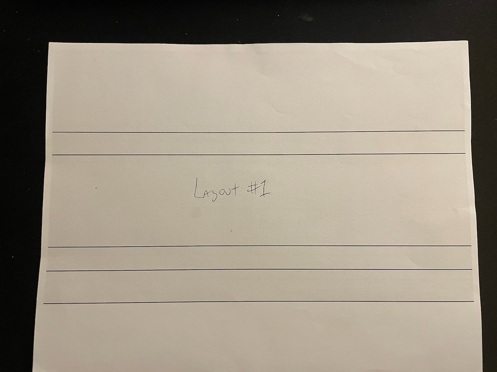
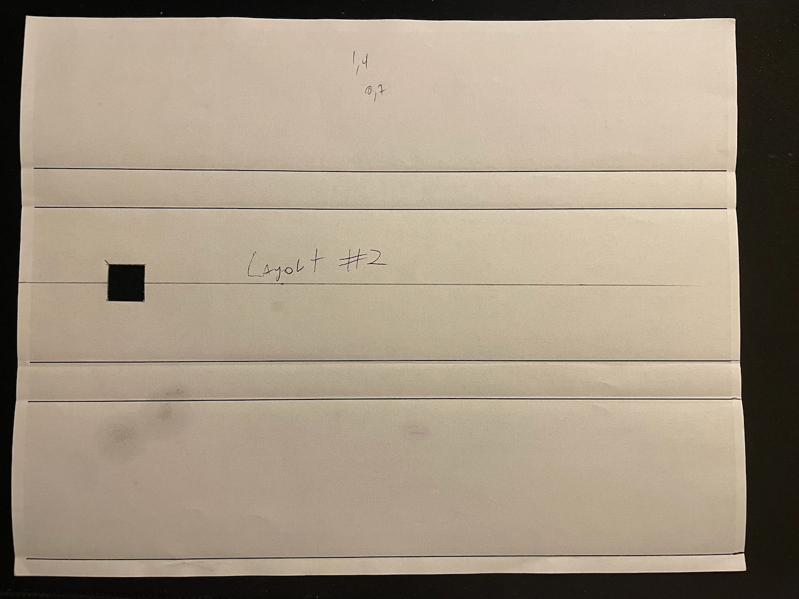
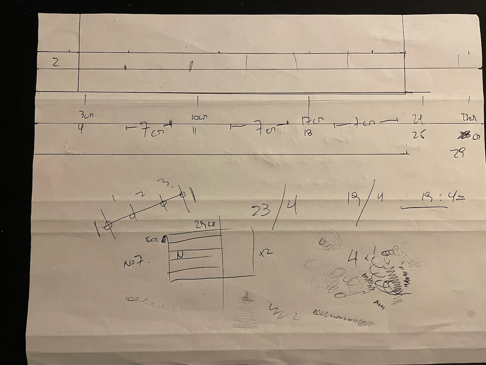
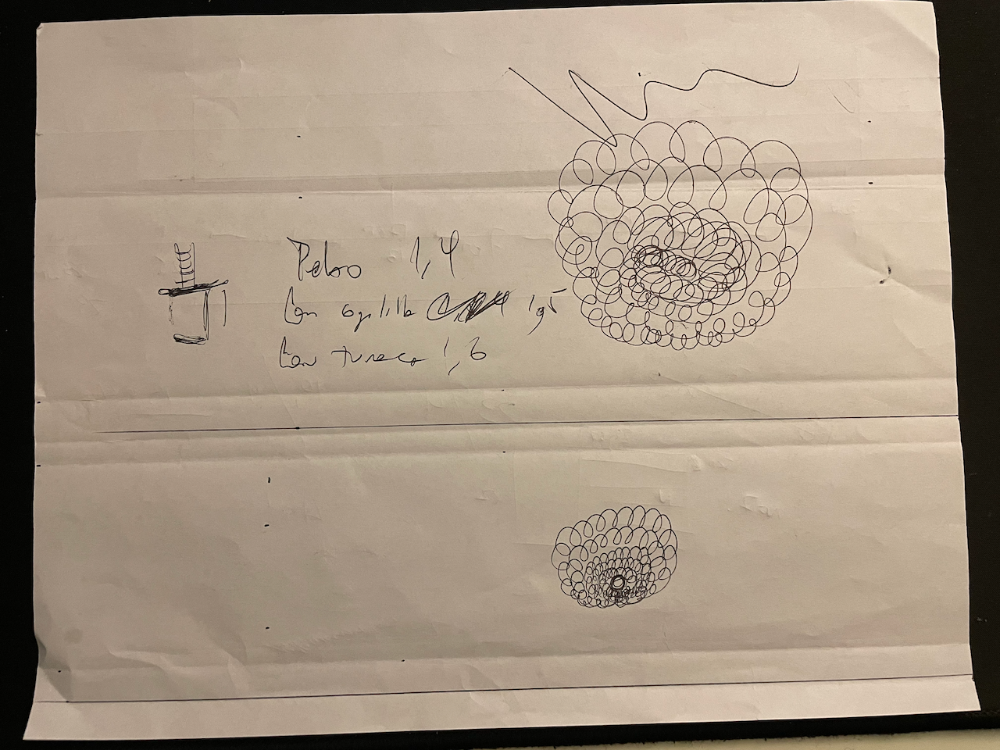
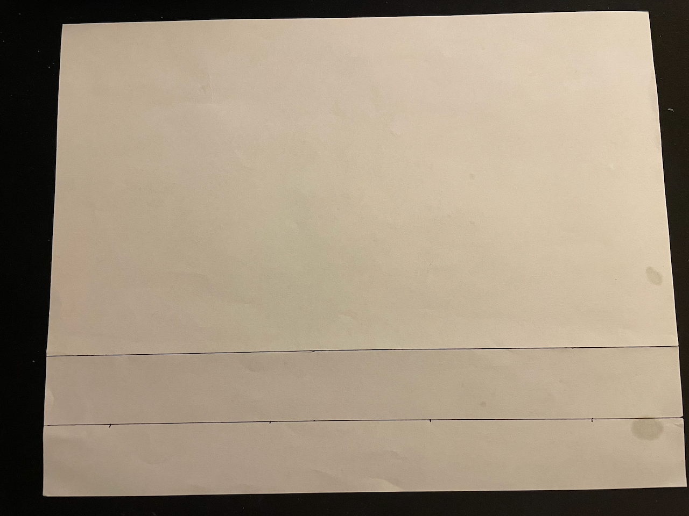
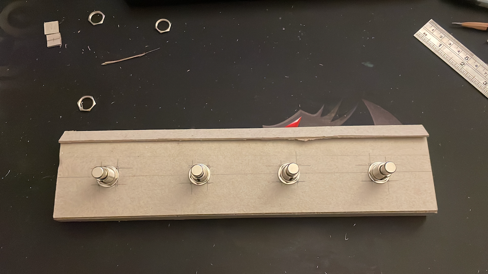
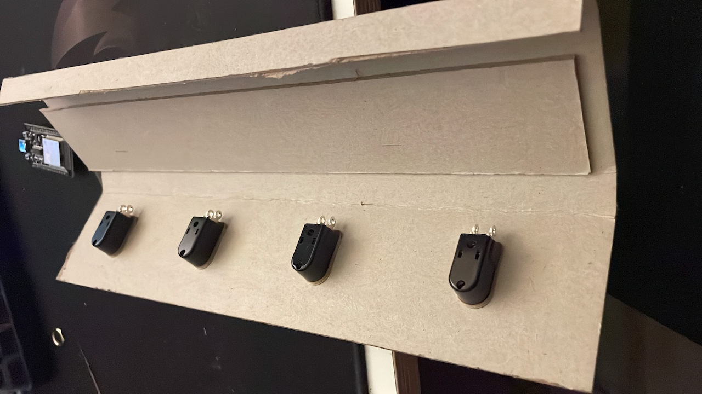
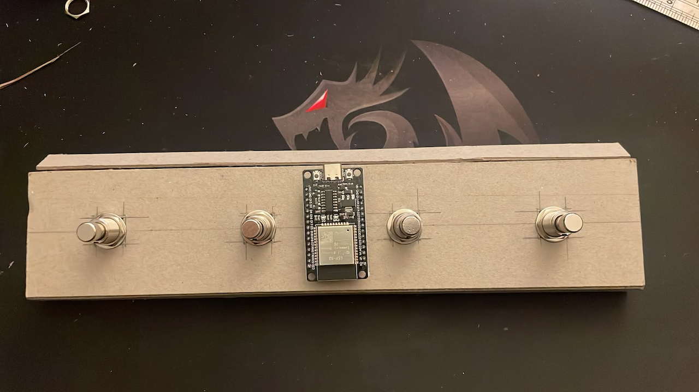
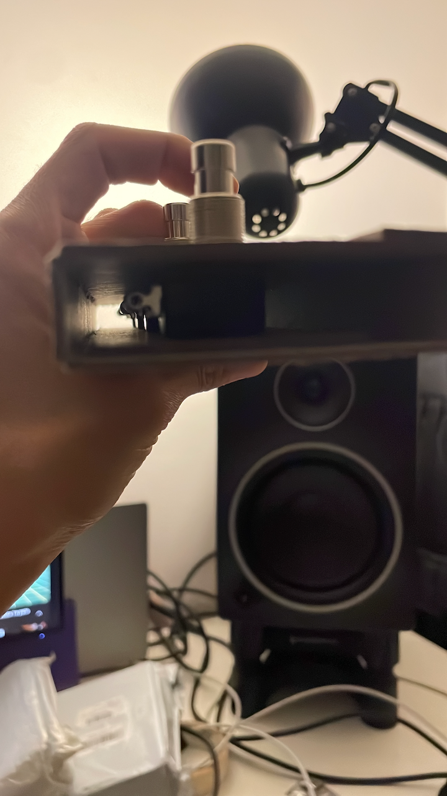
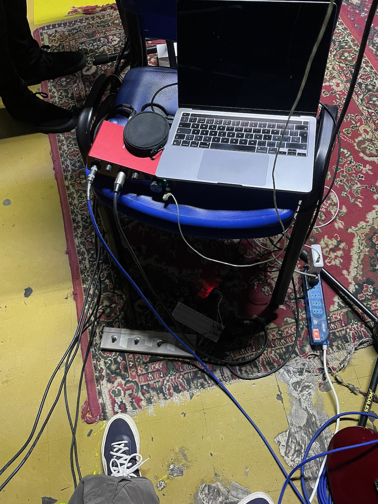

Tocando con los efectos en Logic Pro, el problema siempre es el mismo: para prender un delay o cambiar de distorsión hay que soltar la guitarra e ir al computador. Una pedalera resuelve eso, pero las comerciales con MIDI son caras para lo que hacen, que es básicamente mandar un mensaje cuando uno pisa un botón.

Así que armé una. Es la primera pieza física de lo que vengo llamando Ziniestra, el proyecto de pedales y amplificadores.

## Primero en papel

Antes de cortar nada, probé la forma en hojas de papel. Doblándolas se arma la misma caja que después iba a ser de cartón: una cara inclinada para el pie y pestañas que le dan altura. Hice un par de layouts hasta dar con las proporciones.

<figure class="figura-doble">
  
  
  <figcaption>Layout #1 y Layout #2: la caja como hoja doblada. El segundo ya tiene un recorte de prueba. <!-- completar: para qué es el recorte cuadrado --></figcaption>
</figure>

En el papel también salieron las medidas. Los cuatro pulsadores quedaron a 7 cm uno del otro, en 4, 11, 18 y 25 cm, sobre una caja de 29 cm de largo. Y como cada pulsador ocupa más altura con su golilla y su tuerca que solo, anoté esas alturas para calcular cuánto espacio tenía que quedar adentro.

<figure>
  
  <figcaption>La distribución de los pulsadores: 7 cm entre cada uno.</figcaption>
</figure>

<figure class="figura-doble">
  
  
  <figcaption>El pulsador de perfil, con sus alturas, y la plantilla final con las marcas donde va cada uno.</figcaption>
</figure>

## La caja

La base es cartón piedra: una plancha doblada en ángulo, con una pestaña arriba que le da rigidez. Marqué con lápiz y regla dónde iba cada pulsador, perforé y los fijé con sus tuercas.

<figure>
  
  <figcaption>Los cuatro pulsadores montados. Todavía se ven las cruces de lápiz con que los centré.</figcaption>
</figure>

<figure>
  
  <figcaption>Por debajo: las patas de los pulsadores, listas para soldar.</figcaption>
</figure>

## El cerebro: un ESP32

El ESP32 es un microcontrolador barato que trae bluetooth incorporado. Eso lo vuelve ideal para esto: puede presentarse ante el computador como un dispositivo **MIDI por bluetooth (BLE MIDI)**, que macOS reconoce sin drivers. Cada pulsador va a un pin del ESP32; cuando se pisa, el ESP32 envía un mensaje MIDI. <!-- completar: qué mensaje manda cada pedal (Control Change, número de CC, notas) y qué librería usaste para BLE MIDI -->

<figure>
  
  <figcaption>El ESP32 presentado en su lugar, entre los pulsadores del medio.</figcaption>
</figure>

## Del pie a Logic Pro

En el Mac, la pedalera aparece en *Configuración Audio MIDI* como un dispositivo bluetooth más. Una vez conectada, Logic Pro la ve como cualquier controlador MIDI, y con *Asignaciones de controlador* (o *Learn*) cada pedal queda amarrado a lo que uno quiera: activar o saltar un plugin, cambiar de patch, grabar. <!-- completar: qué efectos/acciones asignaste a cada pedal -->

<figure class="figura-doble">
  
  
  <figcaption>A la izquierda, la caja cerrada y pintada. A la derecha, la primera prueba en la sala de ensayo: notebook con Logic, interfaz de audio y la pedalera en el piso.</figcaption>
</figure>
