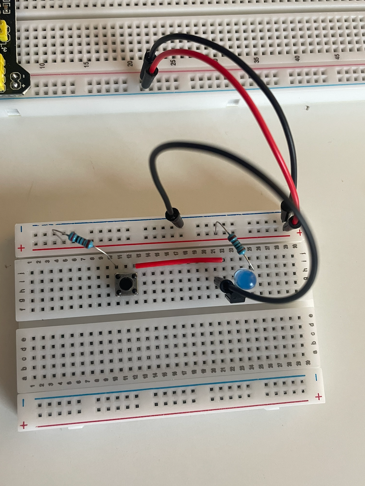
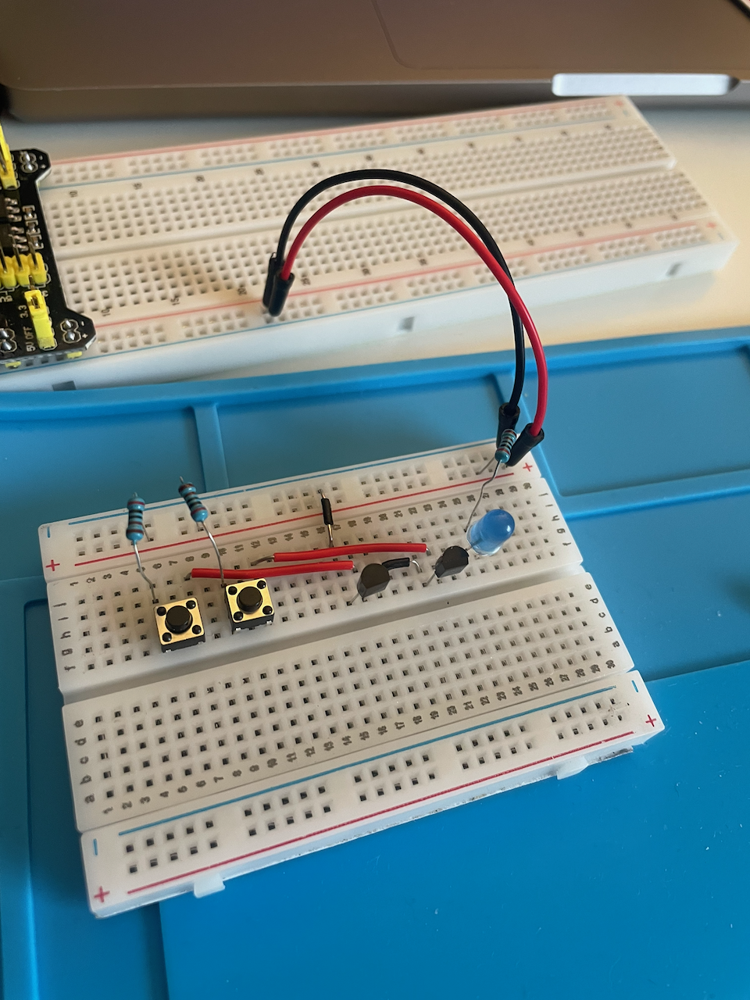

Programar se enseña casi siempre desde arriba: un lenguaje, un editor, una pantalla. Todo lo que hay debajo —el procesador, los chips, la electricidad— queda como una caja negra que simplemente funciona. Esta es una exploración en la dirección contraria, a la que he ido llamando **programación tangible**: partir por abajo, con las manos, y ver de qué está hecho lo digital antes de escribir una sola línea de código.

El material de la exploración es un **kit** muy sencillo: una protoboard, transistores, compuertas lógicas y LEDs. <!-- completar: para quién lo imagino (taller, colegio, curso) y qué otras piezas tiene -->

Y lo digital, en el fondo, está hecho de interruptores. Millones de ellos, apagándose y encendiéndose. Ese interruptor es el **transistor**.

## El transistor como interruptor

Un transistor tiene tres patas. Por dos de ellas circula la corriente que queremos controlar —en este caso, la que enciende un LED—. La tercera, la *base*, es la llave: si le llega una corriente pequeña, el transistor deja pasar la corriente grande; si no, la corta.

El primer circuito del kit es solo eso: un botón que le manda corriente a la base a través de una resistencia, y un LED que se enciende cuando el transistor conduce. Apretar el botón no prende el LED directamente; le *avisa* al transistor que lo prenda. Esa diferencia, aunque parezca mínima, es todo: una señal que controla a otra señal.

<figure class="figura-doble">
  
  <video src="/static/imagenes/kit-demo-switch.mp4" poster="/static/imagenes/kit-demo-switch-poster.jpg" controls muted loop playsinline preload="none" aria-label="Un dedo aprieta el pulsador de la protoboard y el LED azul se enciende."></video>
  <figcaption>El transistor como interruptor: un pulsador, un transistor y un LED.</figcaption>
</figure>

## Dos transistores: la compuerta AND

Si ponemos dos de esos interruptores en serie, uno detrás del otro, la corriente solo llega al LED cuando **los dos** están cerrados. Con un solo botón apretado no pasa nada; con los dos, el LED se enciende.

| Botón A | Botón B | LED |
|:-:|:-:|:-:|
| no | no | apagado |
| sí | no | apagado |
| no | sí | apagado |
| sí | sí | **encendido** |

Eso es una compuerta lógica **AND** (Y): la salida es verdadera solo si ambas entradas lo son. Es la misma operación que aparece en cualquier lenguaje de programación como `a && b`, pero acá no es una abstracción: es corriente que pasa o no pasa, y se ve.

<figure class="figura-doble">
  
  <video src="/static/imagenes/kit-AND-003.mp4" poster="/static/imagenes/kit-AND-003-poster.jpg" controls muted loop playsinline preload="none" aria-label="Se aprieta un pulsador y el LED sigue apagado; al apretar los dos a la vez, el LED azul se enciende."></video>
  <figcaption>La compuerta AND: dos pulsadores, dos transistores en serie. El LED solo se enciende con ambos apretados.</figcaption>
</figure>

## Hacia dónde sigue

Dos transistores y dos botones ya alcanzan para ver una operación lógica. Con unas pocas compuertas más se puede armar una suma, y de ahí se entiende mejor qué quiere decir que un computador «suma»: esa pregunta la sigo en [¿Los computadores suman?](/investigacion/los-computadores-suman/).

Este proyecto es también el punto de partida de un curso, **Programación tangible**, que estoy preparando para la [academia de la Tecnocooperativa](https://academia.tecnocooperativa.cl). Parte con este mismo kit para entender con las manos la base sobre la que funciona hoy la computación. Todavía está en preparación.
